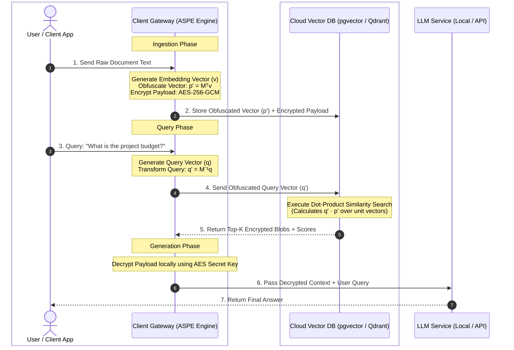

# ASPE Engine (`aspe-engine`)

A lightweight, high-performance Python library for building **Zero-Trust & Privacy-Preserving Retrieval-Augmented Generation (RAG)** systems using **Asymmetric Scalar Product Preserving Encryption (ASPE)** combined with **AES-256-GCM** payload encryption.

Our solution features a **Client-Side Vector Obfuscation Layer (ASPE)**. Before any knowledge data reaches the cloud host, raw text is encrypted using standard AES-256, and vector embeddings undergo a private matrix transformation locally on your network. The cloud host executes similarity matches over obfuscated vector space without ever holding the decryption key or seeing original vector structures. This enables full cloud scalability across any provider while preventing direct data disclosure.

---

## Architectural Overview: Secure RAG Pipeline

Standard RAG architectures require sending sensitive company documents and raw embedding vectors to third-party vector databases. **`aspe-engine` sits between your data source and the cloud**, keeping plaintexts and raw vector topologies strictly inside your private network perimeter.



---

## Key Features for Private Knowledge Bases

- **Universal Cloud Portability:** Deploy to any budget virtual private server or vector database (`pgvector`, Qdrant, Milvus, FAISS, Pinecone) without requiring specialized hardware enclaves (like AWS Nitro or Intel SGX).
- **Zero Raw Data Disclosure:** Cloud providers only store high-dimensional transformed floating-point arrays ($2d$) and encrypted Base64 payloads.
- **Native Cosine Similarity:** Automatic unit vector normalization ensures cloud-side inner products mathematically match exact cosine similarity rankings.
- **Client-Side Data Sovereignty:** Cryptographic transformation matrices ($M, M^{-1}$) and 256-bit AES keys never leave your application boundary.
- **Key Serialization:** Native, secure loading/saving of client keypairs to disk.

---

## Installation

```bash
pip install -r requirements.txt
```

To install locally as an editable package:

```bash
pip install -e .
```

---

## End-to-End RAG Integration Example

Below is a complete workflow demonstrating document ingestion, obfuscated cloud search, and local context preparation for an LLM:

```python
import os
import numpy as np
from aspe import ASPEEngine, ASPEKey

KEY_FILE = "aspe_rag_secrets.json"
EMBEDDING_DIM = 1536  # e.g., OpenAI text-embedding-3-small

# 1. Initialize Engine & Keys locally
engine = ASPEEngine(dimension=EMBEDDING_DIM)

if not os.path.exists(KEY_FILE):
    key = engine.generate_keys()
    key.save_keys(KEY_FILE)
else:
    key = ASPEKey.load_keys(KEY_FILE)

# -------------------------------------------------------------------
# STEP 1: Ingestion Phase (Private Knowledge Base Upload)
# -------------------------------------------------------------------
raw_doc_text = "Project X launch date is scheduled for Q4 2026 with a budget of $5M."

# Generate raw vector locally using your preferred model (OpenAI, HuggingFace, etc.)
raw_doc_vector = np.random.randn(EMBEDDING_DIM).tolist()

# Obfuscate vector (dim 1536 -> 3072) and AES-256 encrypt text
obfuscated_doc_vector, encrypted_payload = engine.encrypt_record(
    key=key,
    vector=raw_doc_vector,
    text=raw_doc_text
)

# Upload `obfuscated_doc_vector` and `encrypted_payload` to your Cloud Vector DB
# (e.g., db.insert(vector=obfuscated_doc_vector, payload=encrypted_payload))

# -------------------------------------------------------------------
# STEP 2: Retrieval Phase (Secure User Query)
# -------------------------------------------------------------------
user_query = "What is the budget for Project X?"
raw_query_vector = np.random.randn(EMBEDDING_DIM).tolist()

# Transform query vector locally using inverse matrix M^-1
obfuscated_query_vector = engine.transform_query(key, raw_query_vector)

# Send `obfuscated_query_vector` to Cloud Vector DB to execute Top-K Search
# The cloud engine ranks documents using standard dot-product similarity
similarity_score = np.dot(obfuscated_query_vector, obfuscated_doc_vector)
print(f"[Cloud Vector Search] Relevance Score: {similarity_score:.4f}")

# -------------------------------------------------------------------
# STEP 3: Generation Phase (Local Decryption for LLM Context)
# -------------------------------------------------------------------
# Decrypt top search results on client side before passing to LLM
decrypted_context = engine.decrypt_payload(key, encrypted_payload)

prompt_for_llm = f"""
Answer the question using only the context below:

Context: {decrypted_context}
Question: {user_query}
"""

print(f"\n[Client-Side Ready Prompt]:\n{prompt_for_llm}")
```

---

## Running Unit Tests

Run the test suite to verify key generation, vector normalization, matrix persistence, and AES decryption:

```bash
python -m unittest discover -s tests
```
