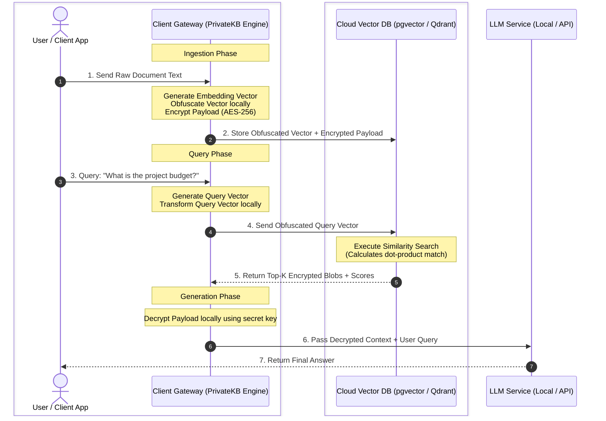

# PrivateKB (`private-kb`)

A lightweight, high-performance Python library for building **Zero-Trust & Privacy-Preserving Retrieval-Augmented Generation (RAG)** systems using vector obfuscation combined with **AES-256-GCM** payload encryption.

Our solution features a **Client-Side Vector Obfuscation Layer**. Before any knowledge data reaches the cloud host, raw text is encrypted using standard AES-256, and vector embeddings undergo a private transformation locally on your network. The cloud host executes similarity matches over obfuscated vector space without ever holding the decryption key or seeing original vector structures. This enables full cloud scalability across any provider while preventing direct data disclosure.

---

## Architectural Overview: Secure RAG Pipeline

Standard RAG architectures require sending sensitive company documents and raw embedding vectors to third-party vector databases. **`PrivateKB` sits between your data source and the cloud**, keeping plaintexts and raw vector topologies strictly inside your private network perimeter.



---

## Key Features for Private Knowledge Bases

- **Universal Cloud Portability:** Deploy to any budget virtual private server or vector database (`pgvector`, Qdrant, Milvus, FAISS, Pinecone) without requiring specialized hardware enclaves (like AWS Nitro or Intel SGX).
- **Zero Raw Data Disclosure:** Cloud providers only store high-dimensional transformed floating-point arrays and encrypted Base64 payloads.
- **Native Cosine Similarity:** Automatic unit vector normalization ensures cloud-side inner products mathematically match exact cosine similarity rankings.
- **Client-Side Data Sovereignty:** Cryptographic transformation keys and 256-bit AES keys never leave your application boundary.
- **Key Serialization:** Native, secure loading/saving of client keypairs to disk.

---

## Installation

```bash
pip install -r requirements.txt
```

To install locally as an editable package:

```bash
pip install -e .
```

---

## End-to-End RAG Integration Example

Below is a complete workflow demonstrating how `PrivateKB` protects your data during document ingestion, query retrieval, and LLM context generation:

```python
import os
import numpy as np
from privatekb import PrivateKBEngine, PrivateKBKey

KEY_FILE = "private_kb_secrets.json"
EMBEDDING_DIM = 1536  # Length of raw vector embedding (e.g., OpenAI)

# 1. Initialize Engine & Keypair locally
engine = PrivateKBEngine(dimension=EMBEDDING_DIM)

if not os.path.exists(KEY_FILE):
    key = engine.generate_keys()
    key.save_keys(KEY_FILE)
else:
    key = PrivateKBKey.load_keys(KEY_FILE)

# -------------------------------------------------------------------
# STEP 1: Client-Side Ingestion (Encrypt Document & Obfuscate Vector)
# -------------------------------------------------------------------
raw_doc_text = "Project X launch date is scheduled for Q4 2026 with a budget of $5M."

# Generate embedding vector locally (using OpenAI, HuggingFace, etc.)
raw_doc_vector = np.random.randn(EMBEDDING_DIM).tolist()

# Obfuscate vector and encrypt text payload locally
obfuscated_doc_vector, encrypted_payload = engine.encrypt_record(
    key=key,
    vector=raw_doc_vector,
    text=raw_doc_text
)

# -> Now safely upload `obfuscated_doc_vector` and `encrypted_payload` to your Cloud Vector DB.

# -------------------------------------------------------------------
# STEP 2: Client-Side Retrieval (Transform Search Query)
# -------------------------------------------------------------------
user_query = "What is the budget for Project X?"
raw_query_vector = np.random.randn(EMBEDDING_DIM).tolist()

# Transform query vector into the protected space for searching
obfuscated_query_vector = engine.transform_query(key, raw_query_vector)

# -> Send `obfuscated_query_vector` to Cloud Vector DB to perform standard vector search.
# The cloud calculates similarity between vectors without knowing raw values.
similarity_score = np.dot(obfuscated_query_vector, obfuscated_doc_vector)
print(f"[Cloud Vector Search] Relevance Score: {similarity_score:.4f}")

# -------------------------------------------------------------------
# STEP 3: Client-Side Generation (Decrypt Context for LLM)
# -------------------------------------------------------------------
# Decrypt top search results locally before building the final prompt
decrypted_context = engine.decrypt_payload(key, encrypted_payload)

prompt_for_llm = f"""
Answer the question using only the context below:

Context: {decrypted_context}
Question: {user_query}
"""

print(f"\n[Client-Side Prompt for LLM]:\n{prompt_for_llm}")
```

---

## Running Unit Tests

Run the test suite to verify key generation, vector normalization, matrix persistence, and AES decryption:

```bash
python -m unittest discover -s tests
```

---

## Theoretical Foundation & Citation

The vector obfuscation scheme implemented in `PrivateKB` is based on **Asymmetric Scalar Product Preserving Encryption (ASPE)** originally proposed by Wong et al. (SIGMOD 2009).

```bibtex
@inproceedings{wong2009secure,
  title={Secure k-nearest neighbor query on encrypted data in cloud computing},
  author={Wong, Wai Kit and Cheung, David Wai-Lok and Kao, Ben and Mamoulis, Nikos},
  booktitle={Proceedings of the 2009 ACM SIGMOD International Conference on Management of Data},
  pages={563--574},
  year={2009},
  organization={ACM},
  doi={10.1145/1559845.1559905}
}
```
